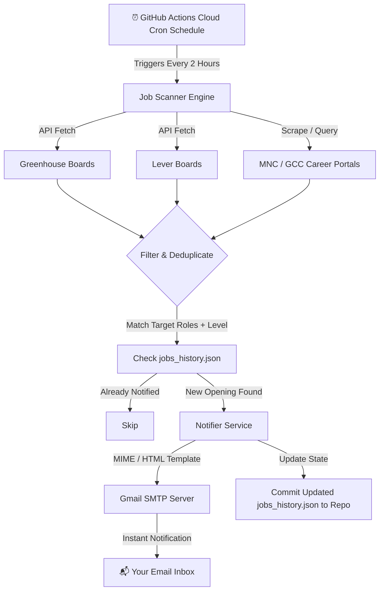

# 🛰️ Cloud Job & Internship Radar (24/7 Automated Alert Bot)

An automated, serverless intelligence bot that runs **24/7 entirely in the cloud** via GitHub Actions. It monitors live Applicant Tracking Systems (Greenhouse, Lever, Workday) and career portals for authentic **Data Analyst, Data Science, and Software Engineering** internships and fresher roles—dispatching rich email alerts the moment a matching opening appears.

---

## 🏗️ System Architecture

---

## ✨ Features

- **24/7 Headless Cloud Execution**: Runs entirely on GitHub Actions runners—zero local computer resources required, operates seamlessly even when you are offline or sleeping.
- **Direct ATS API Integration**: Directly consumes structured REST APIs from Greenhouse and Lever, avoiding bot-blocking and ensuring 100% genuine postings.
- **Strict Role & Experience Filtering**:
  - Focuses on: *Data Analyst, Data Science, Software Engineer, Intern, Fresher*.
  - Automatically filters out: Senior roles (e.g., *Lead, Staff, Principal, 5+ yrs*).
  - Geolocation filtering: *India (Remote prioritized, Hybrid hubs)*.
- **Stateful Deduplication**: Maintains an immutable persistent history of job IDs (`jobs_history.json`) to guarantee zero duplicate alerts.
- **Responsive HTML Email Alerts**: Dispatches clean, mobile-friendly cards with direct application links.

