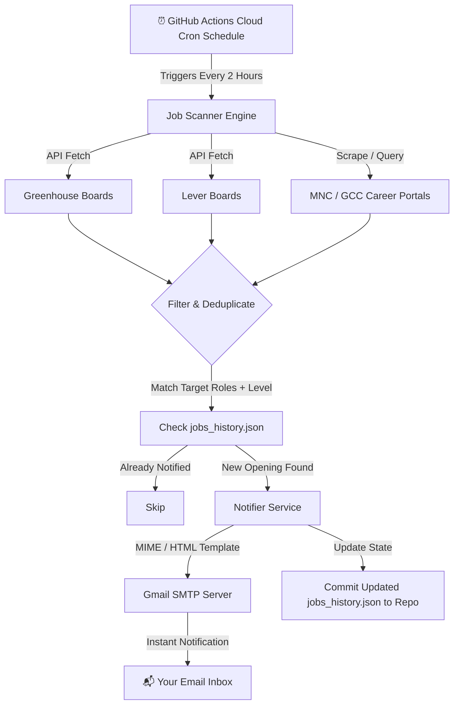

# 🛰️ Cloud Job & Internship Radar (24/7 Automated Alert Bot)

An automated, serverless intelligence bot that runs **24/7 entirely in the cloud** via GitHub Actions. It monitors live Applicant Tracking Systems (Greenhouse, Lever, Workday) and career portals for authentic **Data Analyst, Data Science, and Software Engineering** internships and fresher roles—dispatching rich email alerts the moment a matching opening appears.

---

## 🏗️ System Architecture

---

## ✨ Features

- **24/7 Headless Cloud Execution**: Runs entirely on GitHub Actions runners—zero local computer resources required, operates seamlessly even when you are offline or sleeping.
- **Direct ATS API Integration**: Directly consumes structured REST APIs from Greenhouse and Lever, avoiding bot-blocking and ensuring 100% genuine postings.
- **Strict Role & Experience Filtering**:
  - Focuses on: *Data Analyst, Data Science, Software Engineer, Intern, Fresher*.
  - Automatically filters out: Senior roles (e.g., *Lead, Staff, Principal, 5+ yrs*).
  - Geolocation filtering: *India (Remote prioritized, Hybrid hubs)*.
- **Stateful Deduplication**: Maintains an immutable persistent history of job IDs (`jobs_history.json`) to guarantee zero duplicate alerts.
- **Responsive HTML Email Alerts**: Dispatches clean, mobile-friendly cards with direct application links.

---

## 💼 Why This is a Great Resume & Portfolio Project

Putting this on your resume demonstrates key practical skills sought after by MNCs, GCCs, and top tech companies:
- **DevOps & CI/CD**: Cloud cron scheduling, headless runners, and environment secrets management.
- **API Engineering**: Consuming third-party REST APIs and handling rate limits & network timeouts.
- **Data Engineering**: Data cleaning, schema extraction, and state persistence.
- **Real-World Impact**: You built a tool to solve an actual industry problem—and actively used it to accelerate your own career search!

---

## 🚀 5-Minute Setup Guide

### 1. Create a Repository
1. Create a new GitHub repository (can be **Private** or **Public**), e.g., `job-radar-cloud`.
2. Push or upload the files in this folder to your repository.

### 2. Generate a Gmail App Password
1. Go to your **Google Account Security**: https://myaccount.google.com/security
2. Ensure **2-Step Verification** is turned ON.
3. Search for **App passwords** (or go to https://myaccount.google.com/apppasswords).
4. Enter an app name (e.g., `Job Radar`) and click **Create**.
5. Copy the generated 16-character password (e.g., `abcd efgh ijkl mnop`).

### 3. Add GitHub Repository Secrets
1. In your GitHub repository, navigate to **Settings** > **Secrets and variables** > **Actions**.
2. Click **New repository secret** and add:
   - `GMAIL_USER`: `Atulchavan0020@gmail.com`
   - `GMAIL_APP_PASSWORD`: *(Your 16-character Google App Password)*
   - `ALERT_EMAIL`: `Atulchavan0020@gmail.com`

### 4. Enable Workflow Permissions
1. In your repository, go to **Settings** > **Actions** > **General**.
2. Under **Workflow permissions**, select **Read and write permissions** (so the runner can commit updated `jobs_history.json`).
3. Click **Save**.

### 5. Test Run
1. Go to the **Actions** tab in your repository.
2. Select **24/7 Cloud Job Radar** on the left.
3. Click **Run workflow** > **Run workflow**.
4. Check your inbox! 🚀
